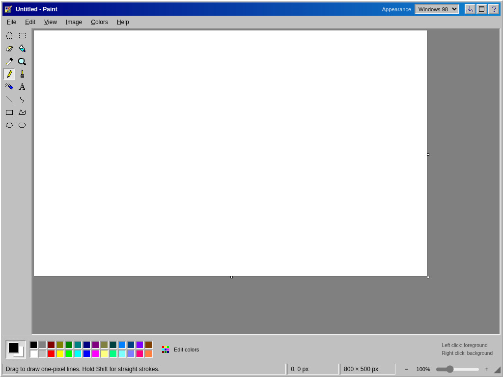

# Classic Paint

A self-contained drawing app with Windows 98, Windows XP, and Windows 7 appearances. Switch **Appearance** in the title bar without losing the picture or undo history.

**[Try it online](http://mspaint.storiesofwood.com/)**



Also available: [Windows XP](docs/images/windows-xp.png) and [Windows 7](docs/images/windows-7.png) appearances.

## Run in a browser

No installation or build step is required:

```bash
./run-web.sh
```

Open **http://127.0.0.1:8765/**. Alternatively, with Node.js 22.12 or newer, run `npm start`.

To host it on your own website, upload **the contents of `dist/`** to a directory on any static web server. Keep the files together; relative asset paths support subdirectories. Use HTTPS for desktop installation, offline caching, clipboard access, and native browser file pickers. Opening `index.html` directly as a `file://` URL does not support JavaScript modules consistently.

## Desktop version

The same application runs in an Electron window, with native Save dialogs, file overwriting, close confirmation, and a persistent local origin for recovery.

```bash
npm ci
npm run desktop
```

On Linux, after installing dependencies, you can also launch the installed Electron binary directly:

```bash
./run-desktop.sh
```

This is a desktop launcher, not a signed Windows/macOS installer. The Electron dependency is pinned in `package-lock.json`. In a supported browser, **File → Install Desktop App** offers the separate PWA installation route.

## Included

- All 16 classic toolbox entries, with independently drawn 16-pixel icons for 98/XP.
- Windows 7 ribbon, quick-access Save/Undo/Redo, selection menu, nine brush choices, and shape gallery.
- Pencil, brushes, spray, eraser/color eraser, connected fill, color picker, magnifier, text, lines, two-bend curves, polygons, and geometric shapes.
- Rectangular/free-form selections; move, eight-handle resize, cut/copy/paste, invert selection, delete, transparent background, and crop.
- Undo/redo, flip, right-angle rotation, resize/skew, inversion, monochrome conversion, canvas resizing, zoom, pixel grid, and thumbnail.
- Edit Colors with hue/saturation map, luminosity control, RGB/HSL/hex fields, and persistent custom colors.
- Attributes, Stretch/Skew, Flip/Rotate, Custom Zoom, Save As, Page Setup, preview, Help, shortcuts, About, and unsaved-change dialogs.
- Image import, drag/drop, PNG/JPEG/24-bit BMP export, printing, and local draft recovery.

## Verification

```bash
npm run check
npm test
```

Open **http://127.0.0.1:8766/tests/** and choose **Run checks**. Without Node, run `python3 -m http.server 8766 --bind 127.0.0.1` from this project folder instead.

The suite exercises production drawing code against real browser canvas pixels, edit history, dialogs, exports, save confirmation flows, keyboard events, icons, and all three layouts at 360, 640, 1024, and 1440 pixels. It uses a separate origin from the normal preview and does not touch that preview's recovery data or clipboard. Pointer capture is stubbed in the engine tests; interactive drawing receives a separate browser check.

Desktop startup and visual regression checks can run headlessly on Linux:

```bash
PAINT_SMOKE_TEST=1 node_modules/.bin/electron --headless --ozone-platform=headless tests/desktop-smoke.cjs
PAINT_SMOKE_TEST=1 node_modules/.bin/electron --headless --ozone-platform=headless tests/screenshots.cjs
```

See [verification and fidelity notes](VERIFICATION.md) for the scope of the audit and differences from Microsoft's originals.

## Implementation

`dist/` contains the complete dependency-free web application. `engine.js` owns pixels and history; `app.js` connects tools, menus, dialogs, files, and recovery; `icons.js` contains the two icon styles; `style.css` contains the three appearances. `desktop/` is a sandboxed Electron wrapper with a narrow IPC interface. Images are processed locally; there is no drawing-upload backend.

Windows and Microsoft Paint are Microsoft trademarks. This is an independent recreation, not Microsoft's original program.
